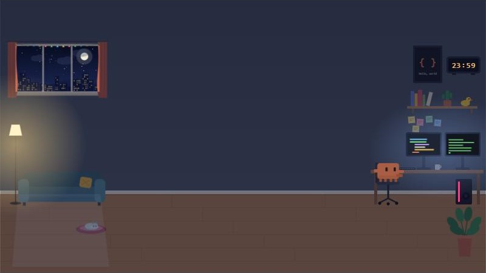

# lofi-theme

A lofi living room drawn behind the chat in the Claude desktop app. The light
follows your clock, and an orange mascot and a kitten react to what the
session is doing.



## What it does

- **Light by the clock.** Dawn, day, golden hour, dusk and night, with the
  lamp, the screens and the city outside the window lit to match. About one
  day in five it rains.
- **A wall clock that tells the time.** Digital, hours and minutes, 24-hour by
  default.
- **A mascot that follows the session.** It works at the desk while Claude
  runs a turn, perks up when you type, and lazes on the couch (scrolling,
  napping, playing with the kitten) while it waits on you or on a long
  command. Late at night, once things go quiet, it sleeps.
- **Small celebrations.** Confetti on a `git commit`, fireworks outside on a
  `gh pr merge`, a cheer on a passing test run and a facepalm on a failing one.
- **A kitten** with a life of its own: the windowsill, the yarn, the warm desk.
- **The chat is untouched.** The room sits at the two sides of the window;
  nothing is drawn behind or over the conversation.

## Requirements

- The Claude desktop app, in a session that loads plugins with function hooks
  (an early-access API; built and tested on Claude Code 2.1.325). The mobile
  app draws the room as a still picture. A terminal draws no backdrop at all.
- A wide window. The room is laid out for about 1900 px across with the
  sidebar collapsed; in a narrower window the furniture slides behind the chat.

## Install

At the prompt of a terminal session:

```
/plugin install lofi-theme --marketplace SegFault03/lofi-theme
```

Answer `y` to add the marketplace, then pick a scope (user is the first one)
and set the options.

From a shell:

```
claude plugin install lofi-theme --marketplace SegFault03/lofi-theme
```

In the desktop app, where `/plugin` does not run: click **+** next to the
prompt box, then **Plugins**, **Add marketplace** with
`SegFault03/lofi-theme`, then **Add plugin**.

A plugin installed at the user scope from a terminal loads in the desktop
app's sessions too.

### From a folder on your machine

Clone the repository, then point Claude Code at the folder:

```
claude plugin marketplace add /path/to/lofi-theme
claude plugin install lofi-theme@lofi-theme
```

Installed this way the plugin is read from the folder itself, so an edit
shows after `/reload-plugins` with no reinstall.

## Options

Set when you install, and afterwards in the config menu (`/config` in a
terminal session). A change reloads the plugin.

| Option | Values | Default | What it does |
| --- | --- | --- | --- |
| `clockFormat` | `24h`, `12h` | `24h` | How the wall clock shows the hour: `17:05` or `05:05`. |
| `timeOfDay` | `auto`, `dawn`, `day`, `golden`, `dusk`, `night` | `auto` | `auto` lights the room by your clock. Name one to keep the room in that light. |
| `wall` | `slate`, `plum`, `forest`, `clay` | `slate` | The colour of the wall. |
| `kitten` | on, off | on | Off for a room with no kitten in it. |
| `celebrations` | on, off | on | Confetti, fireworks, cheers and facepalms. Off keeps the room calm. |
| `rain` | on, off | on | Off keeps the sky clear every day. |
| `tv` | on, off | on | A wall TV with your 5-hour and weekly usage, the chat, the project and its git branch (with the lines not yet committed as `+132/-64`, and under it a card for its pull request and its number, as `Open #16`, where `gh` is installed and signed in; a merged one goes a day after the merge), and how full the context is, each green, yellow past 50% and red past 80%. Until the project or chat name is known it greets you by your login name (read from `USERNAME` or `USER`). Off takes it down. |

From a shell they can be set as the plugin is installed, one `--config` per
option:

```
claude plugin install lofi-theme@lofi-theme --config clockFormat=12h --config wall=plum
```

## The `/room` command

`/room` poses the room by hand and pins it, which is handy for a screenshot
or for trying a look:

```
/room night sleep
/room golden window kitten-sill
/room fireworks
/room rain
/room auto
```

`/room` alone lists every word it knows. `/room auto` hands the room back to
the session.

## Good to know

- **A pull request merged on github.com is not seen**, only `gh pr merge` run
  in the session.
- **The clock runs on the scene's own CSS** between redraws. After the machine
  sleeps, the plugin is meant to draw the room again within a minute or so of
  waking, which sets the clock right.
- **No theme colours are set.** The app keeps its own light or dark panels.
- The mascot is original art, not Anthropic's artwork.

## Development

```
claude plugin validate .
claude plugin test .
node tools/preview.mjs
```

`tools/preview.mjs` serves the room at <http://localhost:4173/> with no app
needed; the query string poses it (see the comment at the top of the file).
`CLAUDE.md` has the layout of the code and the rules the scene must keep, and
`HANDOFF.md` the history behind them.

## Licence

MIT. See [LICENSE](LICENSE).
